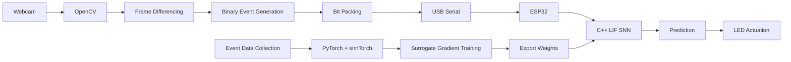

# Event-Driven Spiking Neural Networks (SNNs) for Neuromorphic Edge Vision

### An event-driven vision system combining Spiking Neural Networks, computer vision, and embedded edge computing.

---

## 1. Introduction

Traditional computer vision systems rely heavily on frame-based processing, where image sensors continuously capture and process entire frames, even when most of the scene remains unchanged. Although Convolutional Neural Networks (CNNs) have achieved remarkable performance in visual recognition, their computational requirements can become a significant limitation when deployed on resource-constrained edge devices.

Applications such as autonomous drones, IoT surveillance systems, robotics, and battery-powered smart cameras require intelligent vision systems that can operate with limited computational resources, reduced latency, and lower energy consumption.

**Our project explores an alternative approach inspired by the human visual nervous system: Neuromorphic Vision using Spiking Neural Networks (SNNs).**

Unlike conventional Artificial Neural Networks (ANNs), which communicate using continuous numerical activations, Spiking Neural Networks communicate through discrete electrical-like impulses called *spikes*. Neurons remain inactive until their accumulated membrane potential reaches a specific threshold, at which point they generate a spike.

This event-driven mechanism provides an interesting foundation for developing sparse, temporally aware, and computationally efficient systems.

We aim to develop a real-time, neuromorphic-inspired vision pipeline that converts ordinary webcam footage into event-based representations, processes these events using a trained Spiking Neural Network, and performs inference directly on an ESP32 microcontroller.

Our implementation combines computer vision, computational neuroscience, deep learning, and embedded systems into a single integrated architecture.

## 2. Project Objectives

The primary objective is to design and implement a lightweight, event-driven vision system capable of recognizing movement patterns using a Spiking Neural Network deployed on resource-constrained hardware.

The project focuses on:

- Transforming conventional webcam frames into sparse event representations.
- Exploring temporal information processing through Spiking Neural Networks.
- Implementing Leaky Integrate-and-Fire (LIF) neuron dynamics.
- Training an SNN using surrogate gradient descent.
- Deploying trained neural network parameters on an ESP32.
- Performing neural inference directly on the microcontroller.
- Demonstrating real-time hardware interaction through GPIO-based LED actuation.

Our broader objective is to investigate how neuromorphic computing principles can be applied to practical edge-AI applications.

## 3. System Architecture

The proposed system consists of three major processing stages.

### A. Event Generation — Python and OpenCV

A conventional webcam is used to capture real-time video.

Instead of processing every pixel of every frame, the system downsamples the captured frames to a smaller resolution, such as 16 × 16 pixels, and calculates the difference between consecutive frames.

Pixels exhibiting sufficient intensity changes are converted into binary events.

This produces a sparse representation containing information about where movement has occurred.

The generated event data is then packed into bytes and transmitted to the ESP32 through USB Serial communication.

### B. Spiking Neural Network — PyTorch and snnTorch

The generated event representations are used to train a Spiking Neural Network.

The network utilizes Leaky Integrate-and-Fire neurons to model the temporal accumulation of incoming signals.

Surrogate gradient descent is used during training to overcome the non-differentiability of the spike generation function.

After training, the learned weights and biases are exported into a C++ header file for deployment.

### C. Edge Inference — ESP32

The ESP32 WROOM-32 acts as the edge computing node.

It receives the event stream from the laptop, reconstructs the binary input representation, and processes it using a custom C++ implementation of the trained SNN.

When the network produces a recognized output, the ESP32 triggers a corresponding GPIO action, such as illuminating an LED.

The microcontroller performs inference without requiring the full PyTorch framework or a continuous connection to the training environment.

## 4. Core Working Principles

Our system is built around three fundamental concepts that connect biological inspiration with practical embedded computing.

### 4.1 Event-Driven Visual Processing

Conventional vision systems process complete images at regular intervals. Our approach focuses on identifying meaningful changes between consecutive frames.

Instead of repeatedly processing unchanged background regions, the system generates a sparse binary event representation containing pixels that exhibit significant intensity changes.

This reduces redundant visual information before it reaches the neural network.

### 4.2 Temporal Neural Computation

Biological neurons communicate through electrical impulses rather than continuous numerical activations.

Inspired by this mechanism, our Spiking Neural Network processes information through discrete spikes distributed across multiple time steps.

The Leaky Integrate-and-Fire neuron accumulates incoming signals in its membrane potential. When the potential reaches a predefined threshold, the neuron generates a spike and undergoes a reset.

This allows the network to learn patterns involving both spatial and temporal information.

### 4.3 Embedded Edge Intelligence

A trained neural network is only useful for practical edge applications if it can operate within the computational limitations of embedded hardware.

Our approach separates model training from model inference.

The laptop handles data preparation, neural network training, and parameter optimization. The trained parameters are subsequently transferred to the ESP32, where a lightweight C++ implementation performs inference.

This architecture enables neural processing directly on the microcontroller without requiring a full deep learning framework on the embedded device.

## 5. Design Decisions

Several engineering decisions guide the development of our system.

| Design Choice | Reason |
|---|---|
| 16 × 16 Input Resolution | Reduces input dimensionality and memory requirements. |
| Frame Differencing | Extracts meaningful visual changes instead of repeatedly processing unchanged regions. |
| Binary Event Representation | Provides a simple and compact representation of pixel activity. |
| Bit-Packed Communication | Represents eight binary pixel values using one byte, reducing serial transmission overhead. |
| LIF Neurons | Introduces temporal information processing through membrane potential dynamics. |
| Surrogate Gradient Learning | Enables gradient-based optimization of non-differentiable spike functions. |
| Host–Edge Separation | Keeps computationally intensive training on the laptop and inference on the ESP32. |
| Native C++ Inference | Avoids requiring a full deep learning framework on the microcontroller. |

These decisions prioritize a functional, lightweight, and verifiable implementation while keeping the architecture extensible for future improvements.

## 6. Complete System Workflow

The complete system follows the processing sequence below:

The processing sequence consists of:

1. **Visual Acquisition:** A webcam captures real-time environmental information.
2. **Preprocessing:** Frames are converted to grayscale and reduced to a 16 × 16 representation.
3. **Event Generation:** Frame differencing identifies significant pixel changes and produces binary event maps.
4. **Data Collection:** Event representations are recorded for neural network training.
5. **Model Training:** A Spiking Neural Network is trained using PyTorch and snnTorch.
6. **Parameter Export:** Trained weights and biases are exported into a C++ header file.
7. **Data Transmission:** Event representations are bit-packed and transmitted to the ESP32 through USB Serial.
8. **Neural Processing:** The ESP32 processes incoming events using the deployed LIF-based SNN.
9. **Prediction:** The network produces an output based on accumulated spike activity.
10. **Hardware Actuation:** The ESP32 triggers a GPIO output according to the predicted result.

## 7. Technology Stack

| Component | Technology |
|---|---|
| Programming Languages | Python, C++ |
| Computer Vision | OpenCV |
| Numerical Computing | NumPy |
| Deep Learning | PyTorch |
| SNN Framework | snnTorch |
| Communication | PySerial, USB Serial |
| Embedded Hardware | ESP32 WROOM-32 |
| Development Environment | Arduino IDE |
| Hardware Output | GPIO, LED |

## 8. Validation and Performance Evaluation

The system will be evaluated through multiple verification stages to establish its reliability and practical feasibility.

**Event Generation**
- Verify that moving objects produce meaningful event maps.
- Confirm that static scenes generate minimal activity.
- Evaluate the effect of different event-generation thresholds.

**Communication Reliability**
- Verify correct transmission and reconstruction of event data.
- Evaluate serial communication reliability and transmission latency.

**Inference Consistency**
- Compare predictions from the original Python model and the deployed C++ implementation.
- Test both implementations using identical input sequences and model parameters.

**Classification Performance**
- Evaluate recognition accuracy across training and testing samples.
- Examine model behavior under different movement conditions.

**Embedded Performance**
- Measure ESP32 inference latency.
- Monitor memory usage.
- Measure power consumption where suitable instrumentation is available.

**Hardware Integration**
- Verify that recognized outputs trigger the expected GPIO response.

Performance improvements, including power efficiency and latency reduction, will be reported only after experimental measurements.

## 9. Applications and Future Scope

The concepts explored in this project have potential applications in:

- **Smart Surveillance:** Detecting movement while reducing unnecessary visual processing.
- **Autonomous Robotics:** Processing changing visual information for responsive navigation.
- **Edge AI:** Running lightweight neural inference on resource-constrained devices.
- **Neuromorphic Computing:** Exploring event-driven computation inspired by biological neural systems.
- **IoT Devices:** Developing intelligent sensing systems with limited computational resources.

Future improvements may include:

- Integration with real Dynamic Vision Sensors (DVS).
- Incorporating positive and negative event polarities.
- More sophisticated gesture classification.
- Multi-layer spiking neural network architectures.
- Power consumption and latency benchmarking.
- Deployment on more capable neuromorphic hardware.

## 10. Contributors

This project is developed collaboratively, combining computer vision, machine learning, and embedded systems engineering.

### Anshuman Singh — Embedded Systems & Integration

Responsible for the embedded implementation and overall system integration.

**Contributions:**
- ESP32 WROOM-32 architecture and development.
- C++ implementation of LIF-based inference.
- Serial communication and event-stream reconstruction.
- Integration of trained neural network parameters.
- GPIO-based hardware actuation.
- End-to-end system integration and testing.

### Anmol Agarwal — Computer Vision & Data Engineering

Responsible for the vision-processing and event-generation pipeline.

**Contributions:**
- Webcam acquisition using OpenCV.
- Image preprocessing and resolution reduction.
- Frame differencing and binary event generation.
- Event-stream visualization and data collection.
- Data preparation and serial transmission.

### Aanchal Garg — Artificial Intelligence & Machine Learning

Responsible for the Spiking Neural Network design and training pipeline.

**Contributions:**
- Spiking Neural Network architecture.
- Leaky Integrate-and-Fire neuron implementation.
- Surrogate gradient-based training.
- Model evaluation and prediction analysis.
- Exporting trained weights and biases for embedded deployment.

---

## 11. Project Philosophy

We believe that the future of intelligent edge computing is not necessarily about processing more data, but about processing the right information at the right time.

By exploring event-driven neural computation and deploying it on resource-constrained hardware, this project investigates an alternative direction for building efficient, responsive, and biologically inspired vision systems.

**Less redundant processing. More meaningful events. Intelligent computation at the edge.**

---

**Project:** Event-Driven Spiking Neural Networks (SNNs) for Neuromorphic Edge Vision

**Category:** Neuromorphic Computing | Artificial Intelligence | Computer Vision | Embedded Systems

**Status:** Research and Development
